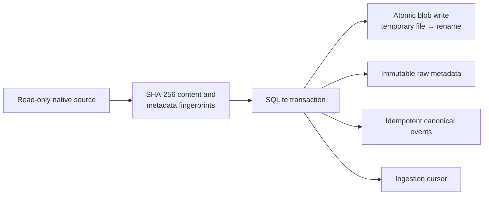

# Storage Architecture

SessionMesh stores imported evidence without modifying native agent stores.
SQLite owns structured metadata and canonical events; a content-addressed
filesystem owns larger raw byte sequences.

## Write path

Blob publication uses a uniquely created temporary file, flushes and
synchronizes its contents, and then renames it to its deterministic address.
Existing content is verified before reuse. Blob publication occurs under the shared SQLite writer lock; metadata,
normalized events, and the ingestion cursor commit in that transaction. A failed
batch therefore cannot advertise progress beyond visible events.

The write path above is shared by local (in-process) ingestion and network
ingestion from a remote collector — the same atomic transaction commits
either way. A batch attributed to a remote collector additionally records
which one: `native_sessions.origin_collector_id` is set from the
authenticated collector's identity (`NULL` for local ingestion), so
downstream cross-tool correlation can require a matching origin — not just a
matching path — before treating two sessions as the same physical workspace.
Two collector-specific tables support this boundary and are covered by the
[network ingestion API reference](../api/ingest.md): `ingestion_collectors`
holds each collector's non-secret identity and hashed bearer token (the raw
token is never persisted), and `ingestion_audit_log` records every accepted
and rejected ingestion attempt, authenticated or not.

## Database behavior

- SQLite runs in WAL mode with foreign keys enabled.
- Connections wait for bounded lock contention instead of failing immediately.
- Database, WAL-related state, and blob content live below the configured
  SessionMesh home.
- The database file and blobs use `0600`; their directories use `0700` on
  Unix.
- FTS5 tables are maintained for later event search.
- Deterministic event IDs make repeated imports idempotent.
- Raw records include content and provenance fingerprints. Reusing an identity
  with different bytes or metadata is rejected as an immutable conflict.

Import-time observations such as current path, source size, modification time,
permissions, and import time are retained from the first successful insert but
are not part of the record's immutable identity. This allows the same native
record to remain idempotent after append, rename, permission change, or replay.
Source generation, byte offset, parser version, and exact bytes define the
stable raw record.

## Retention boundaries

Native stores remain outside SessionMesh retention. Under
[ADR-011](../adr/011-conversation-retention-and-bounded-resources.md), the daemon
now defaults to permanent conversation evidence and disposal of separate tool
bodies. Retained raw content and canonical identities remain immutable. A raw
record shared with any protected event remains in full.

Maintenance commits event/raw metadata deletion before unlinking unreferenced
blobs. A durable queue makes interrupted unlink work recoverable. Publishers
and collectors use the same SQLite immediate-write lock to prevent deletion
races. Unqueued orphans are streamed from the blob directory with a 24-hour
grace period; references are rechecked under the writer lock.

Migration 0005 adds a persistent shared policy, a deletion queue, exact-order
payload-free projections, content-only FTS, and an explicit integer ingestion
key stable across `VACUUM`. Backfill uses bounded batches and a completion
marker, so MCP startup does not rescan the archive. The pool has at most three
connections, each with an 8 MiB SQLite page-cache target.

See [resource management](../operations/resource-management.md) for retained
categories, cleanup schedules, limits, inspection and recovery procedures.

## Backup and restore

Do not copy a live SQLite database file without coordinating with SQLite.
Supported backup tooling must use the SQLite backup API or a checkpointed,
consistent snapshot and must include the content-addressed blob directory.
Restore validates migrations and blob hashes before the service resumes
ingestion.

Native source stores are not part of a SessionMesh backup. They remain under
their owning tools' backup policies.

## Migration policy

Migrations are ordered, forward-only, and applied before repositories accept
traffic. A released migration is never edited in place. Schema changes add a
new migration and tests must cover both a fresh database and reopening an
existing database. Destructive migrations require an explicit export,
validation, and recovery design.
