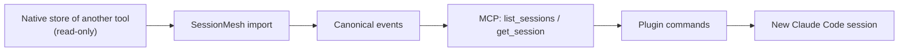

# Claude Code plugin

The `sessionmesh` plugin lets a new Claude Code session load a session that
another agentic tool created and continue that work. It covers every source
SessionMesh imports: Codex, OpenCode, Agy, Grok Build, Continue, and earlier
Claude Code sessions.



## Install

From a Claude Code session on the host that runs SessionMesh:

```text
/plugin marketplace add /path/to/sessionmesh
/plugin install sessionmesh@sessionmesh
```

Restart Claude Code afterwards. The plugin bundles
`bin/sessionmesh-mcp-stdio`, the same bridge as `scripts/sessionmesh-mcp-stdio`
(a test keeps both identical). It uses the same environment contract:

| Variable                       | Purpose                                                           |
| ------------------------------ | ----------------------------------------------------------------- |
| `SESSIONMESH_CONTAINER`        | Container to attach to (default `agenttool-merger-sessionmesh-1`) |
| `SESSIONMESH_MCP_BINARY`       | Native `sessionmesh-mcp` binary; requires `SESSIONMESH_HOME`      |
| `SESSIONMESH_MCP_ALLOW_WRITES` | Stays `false`; the plugin commands never write                    |

If `scripts/install-sessionmesh-connectors claude` registered a user-level
`sessionmesh` server earlier, both servers can coexist. The plugin's tools are
named `mcp__plugin_sessionmesh_sessionmesh__*`.

## Commands

| Command                                       | Effect                                                                                                    |
| --------------------------------------------- | --------------------------------------------------------------------------------------------------------- |
| `/sessionmesh:sessions [tool]`                | Lists imported sessions, newest first, as metadata only                                                   |
| `/sessionmesh:continue [id \| tool \| words]` | Selects a session, loads it progressively, verifies it against the repository, and proposes the next step |

`/sessionmesh:continue` resolves its argument as a session ID, a tool name, or
search words. If several sessions fit, it asks which one to use instead of
guessing. It loads the newest messages first and states when the context was
truncated. For sessions that belong to the current project's global session it
also reads the compact handoff.

## Searching sessions

Four routes exist:

- **In the pane:** the search field of the [pane](#pane-beside-the-chat) searches
  all sessions and lists the matching ones with their hit counts.

- **In Claude Code:** `/sessionmesh:continue <words>` runs `sessionmesh_search`
  with the words, then offers the matching sessions to choose from. The search
  tool returns event IDs, native session IDs, kinds, timestamps, and source
  provenance, but no message text. The text comes from `sessionmesh_get_session`
  after you choose a session.
- **In the Web UI:** the search field searches the content of all tools and
  selects the matching session in the timeline.
- **Over REST:** `GET /api/v1/events/search?query=<words>&limit=<n>` with the
  bearer token returns the same payload-free matches.

Search uses the full-text index over conversation content, so use distinctive
words. `sessionmesh_list_sessions` only filters by tool and cannot search titles.

## Pane beside the chat

The `sessionmesh-pane` plugin (`plugins/sessionmesh-pane`) is a Claude Code mod
that keeps the newest sessions visible in a pane beside the conversation. Filter
buttons narrow the list to one tool, and pressing a session puts
`/sessionmesh:continue <id>` into the prompt box without sending it. The search
field above the list sends the typed words to `sessionmesh_search`, quotes every
word so that characters such as `-` or `:` are not read as full-text syntax,
groups the matching events by session, and names the ten sessions with the most
hits. The search tool returns the oldest matches first, so the pane reads at
most four pages of 100 matches and says in its footer when more exist; narrow
the words in that case. It refreshes
at session start, after each turn, and on demand, and `/sessionmesh-pane`
reopens it. It reads only `sessionmesh_list_sessions`, `sessionmesh_search` and
`sessionmesh_get_session` through the `sessionmesh` plugin's MCP server and shows
load and search errors in its footer.

```text
/plugin install sessionmesh-pane@sessionmesh
```

## MCP tools behind the plugin

The plugin relies on two read-only tools documented in the [MCP reference](../api/mcp.md):
`sessionmesh_list_sessions` and `sessionmesh_get_session`. They require a
SessionMesh image that includes them; an older service reports an unknown tool.

## Security

- Native stores stay read-only. The plugin reads derived events only.
- Message text is redacted with the handoff redaction boundary, bounded to 50
  messages of 4 KiB each, and marked `untrusted` and `ingestion_excluded`.
- The command instructions tell Claude to treat the history as data, never to
  run commands or follow links because history says so, and to verify claims
  against the repository before acting.
- Redaction is pattern-based and best-effort. Do not rely on it for secrets that
  do not look like credentials.
- Commands allow only read-only SessionMesh tools plus read-only Git and file
  inspection. Recording tasks or decisions needs `SESSIONMESH_MCP_ALLOW_WRITES`
  and is not part of this plugin.
- Generated output must not be re-imported as native session input.

## Limitations

- Sessions appear only after the daemon or a collector imported them. Agy
  provides prompt history rather than complete assistant trajectories, and Grok
  Build or other sources may be blocked by damaged native records noted in the
  [implementation status](../development/implementation-status.md).
- Session order uses the timestamp of each session's newest event
  (`last_activity_at`), because several importers never set session start or end
  times. It is a selection aid, not the exact cross-source chronology of ADR-009.
  Filter names are `codex`, `opencode`, `agy`, `grok`, `continue`, and
  `claude-code`.
- The plugin continues work in a new Claude Code conversation. It does not
  resume the other tool's native session; use that tool's own resume command for
  that.
